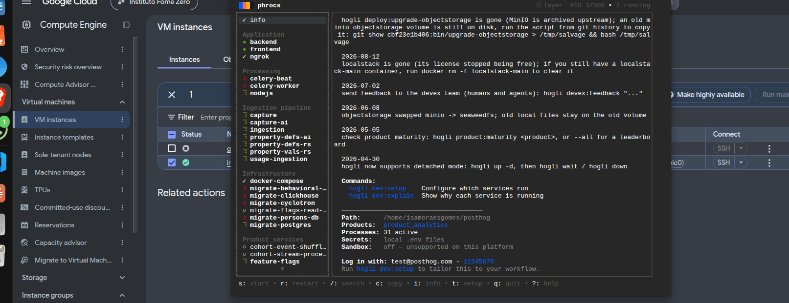

# PostHog SuperDay prep

Hi, I'm Isa. This is everything I did to get ready for a SuperDay as a support engineer at PostHog.

None of it was asked for. I wanted to arrive already knowing what a support ticket feels like from the inside, so I built myself a day of them.

**[Open the interactive runbook →](https://isathepigeon.github.io/posthog-superday/)**

---

## 1. I got PostHog running myself

I forked the repo and cloned it. The build died on my laptop, which only has 8GB of RAM, so I moved it onto a Google Cloud VM I already had from another project. Ubuntu 24.04, 16GB.

From there: `flox activate`, then `hogli start`. 31 processes, all the logs in one terminal UI.

In the end I ran the actual exercises against PostHog Cloud, which is what the team suggested in the SuperDay Slack channel. The local stack was not the shortest path to what I was trying to learn.

But getting it up taught me the architecture, and that mattered more than I expected. When I later had to reason about where a session recording can get lost, I already knew what sits between the browser and the dashboard: the capture endpoint, the queue, the service that assembles sessions, storage, and only then the UI. Knowing that chain is what let me tell "delayed" apart from "lost".

## 2. I built a small site and broke it on purpose

I needed a customer, so I played one. I put a fake shop page on my own site's project and planted real bugs in it, one per ticket.

**`disable_session_recording: true`** in the init. Session replay stops; everything else keeps working. That split, one product dead and the rest alive, is the signature of a disabled setting rather than an outage.

**A renamed event.** `product_added_to_cart` became `cart_item_added`. Every saved chart pointing at the old name flatlines while the app stays perfectly healthy and nobody complains.

Then I investigated them as if I had no idea what was wrong. Committing the clean version first meant `git diff` showed exactly what I had broken and `git checkout` undid it in one command. The lab files are in [`lab/`](lab/).

## 3. I ran a day, not a ticket

Two tickets, deliberately more work than fits in the time:

- **Dana**, Enterprise, tagged `churn_risk`. Session recordings stopped for her whole team, mid usability study, three days already lost.
- **Priya**, Enterprise, tagged `top_20`. Weekly active users dropped 30% over a weekend, with a board meeting at 16:00 and that chart in the deck.

I triaged them against the handbook's actual rules: response targets by plan, the tags that have to be resolved or handed over by end of rotation, paid before community. Then I wrote the acknowledgements, worked the investigations, and wrote the final replies and the handover.

Both root causes found. The write-ups are in the runbook.

## What I learned that I did not expect

**A deadline is not a priority.** It tells you when to start, not what to do first. Estimate the work, double it, subtract from the deadline. Before that time, the hours belong to whatever is actively losing data.

**The SLA clock measures the first reply, not the fix.** Twenty minutes of short acknowledgements at the start of the day buys the whole day.

**Configuration is not state.** The server saying "recording is enabled" and the SDK config holding recording options both tell you nothing about whether anything is being recorded. Three things answer that, and none of them is a settings page: `posthog.sessionRecordingStarted()`, the absence of `$snapshot` in the console, and the absence of `/s/` in the network tab.

**"We didn't change anything" is scope, not a lie.** The person writing didn't change anything. Someone else on their team might have.

**Tags don't always mean priority.** Both my tickets were Enterprise, so `churn_risk` and `top_20` couldn't break the tie. What they decide is handling: who else needs looping in.

---

## How this was made

I built the exercise with Claude: the tickets, the queue, the runbook page. The investigations, the triage and all the customer replies are mine. Where Claude got something wrong I pushed back, and a few of those corrections are the most useful things in here.

## Stack

Vanilla HTML, CSS and JavaScript, no build step. State lives in `localStorage`.
